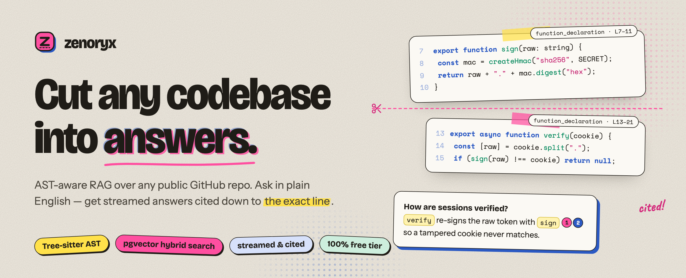
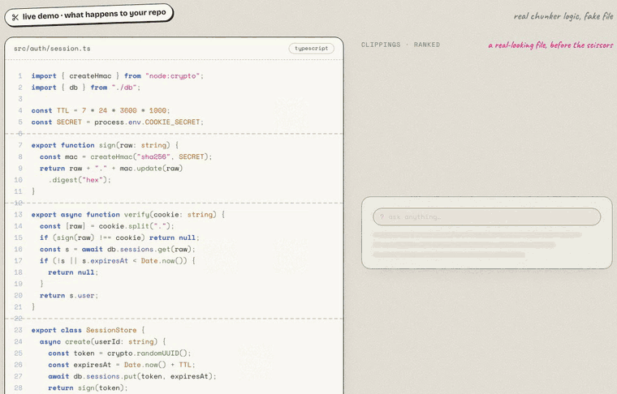
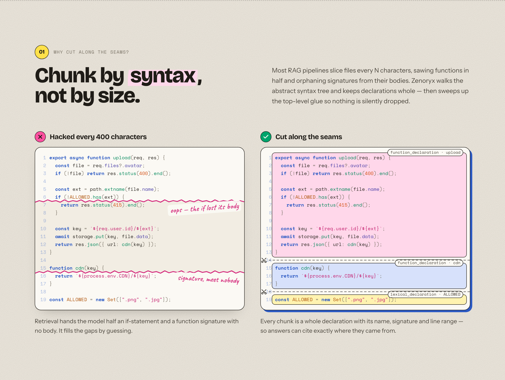
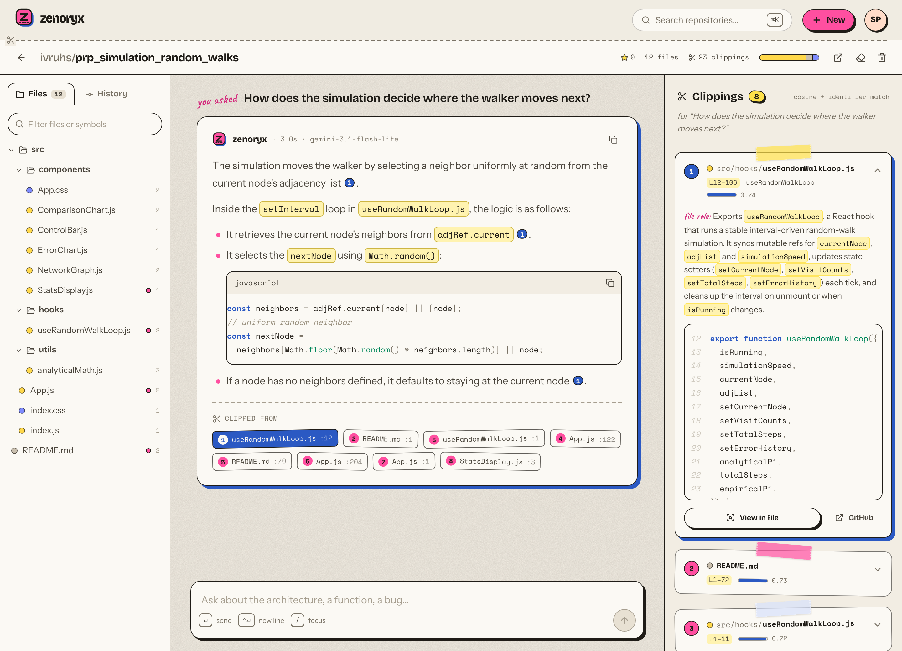
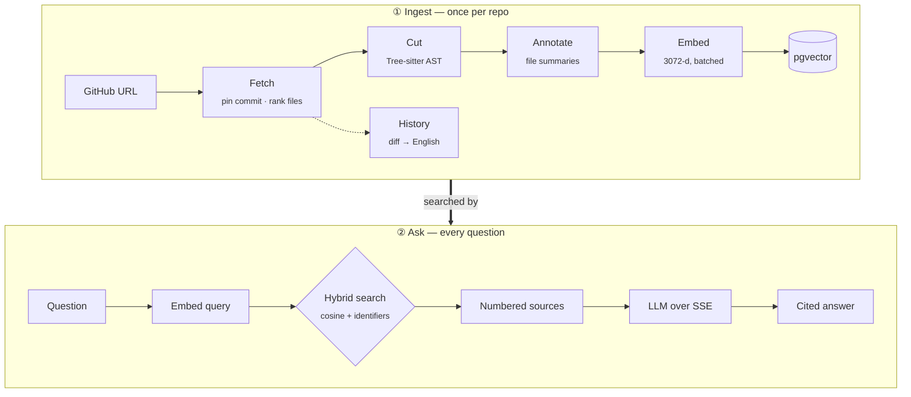
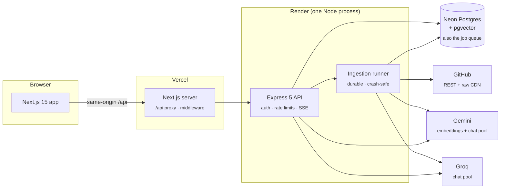

<p align="center">
  
</p>

<p align="center">
  <a href="https://github.com/ivruhs/Zenoryx/actions/workflows/ci.yml"></a>
  
  
  
  
  
  <a href="LICENSE"></a>
</p>

<p align="center">
  <a href="https://zenoryx.vercel.app"><b>Live demo</b></a> ·
  <a href="#️-how-it-works">How it works</a> ·
  <a href="#️-architecture">Architecture</a> ·
  <a href="#-quick-start">Quick start</a> ·
  <a href="#-api-reference">API</a>
</p>

---

**Zenoryx** turns any public GitHub repository into something you can *talk to*. It parses the code into its real syntax tree, cuts it at the seams (whole functions, classes and methods), embeds every piece into a vector index, and then pastes the right pieces back together as a **streamed answer where every claim is cited down to the exact file and line**.

<p align="center">
  
  <br/>
  <sub>The landing page's live demo: real chunker logic, cutting a file along its seams and citing the clippings it used.</sub>
</p>

## ✂️ Why cut by syntax?

Most RAG pipelines split files every *N* characters. That slices functions in half, orphaning signatures from their bodies, so retrieval hands the model fragments and it fills the gaps by guessing. Zenoryx walks the **Tree-sitter AST** instead and keeps every declaration whole. Top-level glue (imports, route wiring, config) is swept up separately so nothing is silently dropped.

<p align="center">
  
</p>

## 🖼️ The workspace

<p align="center">
  
</p>

<p align="center"><sub>A real question about a real repo: a file explorer on the left, a streamed answer with <code>[n]</code> citation stickers in the middle, and on the right the "clipping" it came from, pinned to exact lines on GitHub.</sub></p>

**Also in the app:**
- a pre-flight **scan report** that ranks every file before you index;
- a live **ingestion console** with an overall percentage and ETA;
- an **AST inspector** that shows how each file was cut;
- AI-summarized **commit history**;
- a **⌘K** command palette;
- a fully **responsive** mobile layout.

## ⚙️ How it works



| Stage | What happens |
|---|---|
| **Fetch** | Resolve the default branch and pin its commit SHA. Read the whole tree in one call and rank files (entry points and core directories score up; tests, configs and vendored code score down). The top 36 are selected. |
| **Cut** | Download files from GitHub's raw CDN (no API quota) and split them with Tree-sitter into whole declarations. Large classes are split into their methods, small neighbours are merged, and unsupported languages fall back to overlapping line windows. |
| **Annotate** | One LLM call per *group* of files writes a 1–2 sentence role summary for each file. Each chunk is embedded together with its file's summary. |
| **Embed** | Gemini `gemini-embedding-001` produces 3072-d vectors in token-budgeted batches, bulk-inserted into pgvector. |
| **History** | The most recent commits get plain-English summaries of their diffs. |
| **Ask** | The question is embedded (merged with the previous one for short follow-ups), retrieved with hybrid search, and answered over SSE with numbered citations. |

## 🏗️ Architecture



### Engineering highlights

| | |
|---|---|
| 🧠 **Hybrid retrieval** | pgvector cosine similarity, re-ranked with a lexical boost for exact identifiers (ask about `useAuthStore` and the chunk defining it wins). Results are capped per file for diversity, and tests and docs are down-weighted unless you ask about them. |
| 📌 **Citations to the line** | Every source is numbered and pinned to `file:start–end` at the exact indexed commit, so GitHub links never drift. |
| 🔀 **Quota-aware model pool** | Seven free-tier models (a Gemini Flash-Lite pool plus Groq `gpt-oss-120b` / `gpt-oss-20b` / `qwen3`) behind one gateway. Each model has its own RPM/TPM token bucket, so calls wait for budget instead of hitting 429s; models whose daily quota is spent are parked. Q&A prefers Gemini, ingestion prefers Groq, prompts are sized per model, and streams only fail over before the first token. |
| 🗃️ **Postgres is the queue** | No Redis. Jobs are claimed with an atomic `UPDATE … WHERE status = 'PENDING'`, keep a 20s heartbeat, and retry with exponential backoff. Only stale jobs are recovered on boot, which makes rolling deploys safe, and orphaned jobs are re-queued lazily when polled, so the database can still scale to zero. |
| 🔐 **Secure by default** | bcrypt (cost 12) with constant-time login, HMAC-SHA256 signed HttpOnly session cookies, instant revocation, per-account auth rate limits, ownership checks on every route, and open-redirect-proof post-login redirects. |
| 🌊 **Robust streaming** | SSE with heartbeats, client-disconnect aborts that stop spending quota, token batching per animation frame, and memoized history so long conversations stay smooth. |
| 🧪 **Tested end to end** | `node:test` unit and integration suites, a full ingest → ask → delete E2E run, and a 35-check Playwright sweep across desktop and mobile. |

### Runs on $0

| Service | Free-tier constraint | How Zenoryx stays inside it |
|---|---|---|
| **Neon** (Postgres) | Compute scales to zero; cold starts take seconds | The health check never touches the DB, connections tolerate a 30s wake-up, and there is no background polling |
| **Gemini** embeddings | 1,000 texts/day, ~30K tokens/min | Token-budgeted batches, a client-side limiter, per-file (not per-chunk) summaries, and up to 180 chunks per repo |
| **Gemini** chat | ~20 requests/day *per model* | Rotates across a pool of models and reserves them for interactive Q&A |
| **Groq** chat | ~8K tokens/min per model | Per-model token buckets, prompts sized to fit, and a pool of three models |
| **GitHub** | 60 API calls/hour without a token | File contents come from the raw CDN (no quota), plus a 5-minute metadata cache; about 12 calls per repo |
| **Render / Vercel** | Free web service / hobby plan | One Node process runs both the API and the ingestion runner |

## 🧰 Tech stack

| Layer | Tools |
|---|---|
| **Web** | Next.js 15 (App Router), React 19, Tailwind CSS 4, TanStack Query, react-hook-form + zod, react-markdown, Prism |
| **Design** | A light "cut & paste" risograph-zine system. Type: Bricolage Grotesque, Instrument Sans, Space Mono and Caveat. Motifs carry meaning: scissor cut-lines mark chunk boundaries, taped clippings are sources, rubber stamps are statuses. |
| **API** | Node 20+, Express 5, Prisma 6 (`pg` driver adapter), pino, helmet, express-rate-limit |
| **Retrieval** | Tree-sitter (JS, TS, TSX, Python, Java, C++), pgvector, Gemini `gemini-embedding-001` (3072-d) |
| **LLMs** | Gemini Flash-Lite pool and Groq `gpt-oss-120b` · `gpt-oss-20b` · `qwen3.8-27b`, all on free tiers |
| **Infra** | Vercel (web), Render (API), Neon (Postgres), GitHub Actions (CI) |

## 🚀 Quick start

**Prerequisites:** Node 20.10+, plus free accounts for [Neon](https://neon.tech), [Google AI Studio](https://aistudio.google.com) and [Groq](https://console.groq.com). A GitHub token is optional.

```bash
git clone https://github.com/ivruhs/Zenoryx.git && cd Zenoryx

# 1 · API
cd backend
cp env.example .env          # fill in DATABASE_URL, COOKIE_SECRET, GEMINI_API_KEY, GROQ_API_KEY
npm install
npm run migrate              # applies Prisma migrations (enables pgvector)
npm run doctor               # checks the DB, every model in the pool, embeddings, GitHub
npm run dev                  # → http://localhost:8000

# 2 · Web (second terminal)
cd ../frontend
cp .env.example .env         # BACKEND_URL=http://localhost:8000
npm install
npm run dev                  # → http://localhost:3000
```

Open <http://localhost:3000>, create an account and paste `expressjs/cors`. It's ready to question in about 30 seconds.

<details>
<summary><b>Environment variables</b></summary>
<br/>

**`backend/.env`** (template: [`backend/env.example`](backend/env.example))

| Variable | Required | Notes |
|---|:---:|---|
| `DATABASE_URL` | ✅ | Postgres with pgvector. On Neon, run `CREATE EXTENSION IF NOT EXISTS vector;` once. |
| `COOKIE_SECRET` | ✅ | 32+ random bytes: `node -e "console.log(require('crypto').randomBytes(32).toString('hex'))"` |
| `GEMINI_API_KEY` | ✅ | Embeddings and the primary chat pool. |
| `GROQ_API_KEY` | ⭐ | Chat pool for ingestion and failover. |
| `GITHUB_TOKEN` | | Raises GitHub's limit from 60 to 5,000 requests per hour. No scopes needed. |
| `PORT` | | Default `8000`. |
| `TRUST_PROXY` | | Proxy hops in front of the API: `1` for Render alone, `2` behind the Vercel rewrite. |
| `FRONTEND_URL` | | CORS allow-list, only needed for cross-origin browser calls. |
| `GEMINI_CHAT_MODELS` / `GROQ_CHAT_MODELS` | | Comma-separated model pools, in preference order. |
| `MAX_FILES` / `MAX_CHUNKS` / `QA_PER_HOUR` | | Per-repo budget (default 36 files / 180 chunks) and per-user question limit. |

**`frontend/.env`** (template: [`frontend/.env.example`](frontend/.env.example))

| Variable | Notes |
|---|---|
| `BACKEND_URL` | Where the API runs. The browser never calls it directly; Next.js proxies `/api/*` to it. |
| `NEXT_PUBLIC_SITE_URL` | Public URL, used for absolute Open Graph links. |

</details>

<details>
<summary><b>Scripts</b></summary>
<br/>

| Where | Command | What it does |
|---|---|---|
| `backend` | `npm run dev` | API with auto-reload |
| `backend` | `npm run doctor` | Connectivity and quota check for every external dependency |
| `backend` | `npm run migrate` | Apply database migrations |
| `backend` | `npm run test:unit` | Pure-logic tests (chunker, ranking, crypto, retrieval, limiter, runner) |
| `backend` | `npm test` | Adds HTTP integration tests against your database (test data is cleaned up) |
| `backend` | `npm run test:e2e` | Adds a full run: validate → ingest a real repo → stream an answer → delete |
| `frontend` | `npm run dev` / `build` / `lint` | Next.js dev server, production build, ESLint |

</details>

## ☁️ Deployment

All on free plans:

| Piece | Where | Settings |
|---|---|---|
| **API** | Render (free web service) | Root `backend`. Build: `npm ci && npm run build` (also runs migrations). Start: `npm start`. Env: the backend variables plus `NODE_VERSION=22`, `TRUST_PROXY=2`. Or use [`render.yaml`](render.yaml) as a Blueprint. |
| **Web** | Vercel | Root `frontend`. Env: `BACKEND_URL=https://<your-api>.onrender.com` |
| **DB** | Neon | Free tier, with the `vector` extension enabled |

The ingestion runner lives inside the API process, so there's no separate worker service to pay for or keep alive.

## 📡 API reference

<details>
<summary>All routes are served under <code>/api</code> (and at the root for older clients).</summary>
<br/>

| Method | Route | Description |
|---|---|---|
| `POST` | `/auth/register` · `/auth/login` · `/auth/logout` | Session lifecycle |
| `GET` | `/auth/me` · `/auth/session` | Current user (401 vs. soft `{ user: null }`) |
| `POST` | `/projects/validate` | Pre-flight scan: metadata, language mix, ranked file selection |
| `POST` | `/projects` | Create and enqueue (returns the existing project for duplicates) |
| `GET` | `/projects` · `/projects/:id` · `/projects/:id/status` | Listing, details, live progress |
| `POST` | `/projects/:id/retry` | Retry a failed ingestion |
| `GET` | `/projects/:id/files` · `/projects/:id/chunks?path=` | File explorer and per-file AST chunks |
| `GET` | `/projects/:id/commits` | AI-summarized commit timeline |
| `GET` / `DELETE` | `/projects/:id/messages` | Conversation history |
| `DELETE` | `/projects/:id` | Cancel any running job and delete vectors, commits and chat |
| `POST` | `/qa` | SSE stream: `sources` → `token`* → `done` \| `error` |

</details>

<details>
<summary><b>Project structure</b></summary>
<br/>

```
backend/
  src/
    app.js · server.js            Express app (side-effect free) and process entrypoint
    jobs/runner.js · ingest.js    Durable Postgres-backed queue and the ingestion pipeline
    services/                     github · llm (quota-aware pool) · embedding · vector (hybrid search)
    lib/                          chunker (Tree-sitter) · fileUtils (ranking) · githubUrl · logger
    controllers/ routes/ middleware/ auth/ prisma/
  test/                           unit + integration + e2e (node:test)
  scripts/doctor.js               connectivity and quota check
frontend/
  app/                            (auth) and (app) route groups, landing, 404, error boundary
  components/                     landing · auth · dashboard · ingest · workspace · app · ui
  lib/ hooks/                     API client, SSE reader, formatting, pipeline metadata
docs/readme/                      README images
```

</details>

<details>
<summary><b>Troubleshooting</b></summary>
<br/>

- **"Today's free Gemini embedding quota is used up"**: the free tier allows 1,000 embeddings per day (about 5–8 repos). It resets at midnight US Pacific, and the message tells you how long is left.
- **The first request after a while is slow**: Render and Neon free tiers sleep when idle. The first request wakes them, which takes about 30 seconds.
- **"GitHub API rate limit reached"**: anonymous access allows 60 calls per hour. Add a free `GITHUB_TOKEN` to raise it to 5,000.
- **`npm run doctor`** prints the health of every dependency and model in one go. Start there.

</details>

## 📄 License

[MIT](LICENSE) © Shubham Gopal Prasad

<p align="center"><sub>Cut with care · printed with Next.js, Express &amp; pgvector</sub></p>
