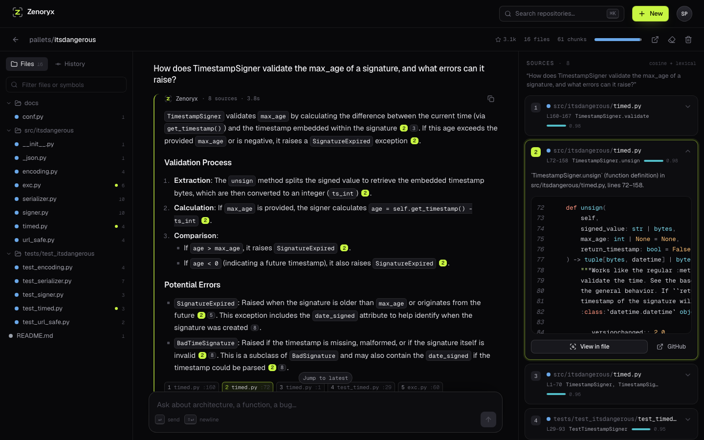
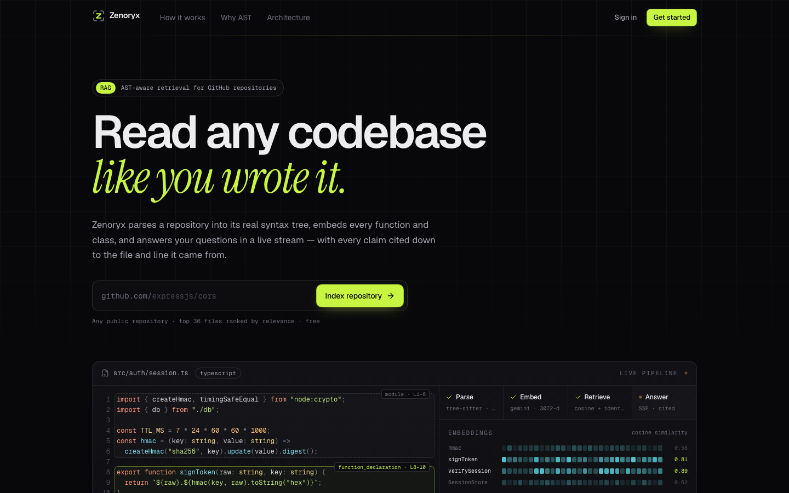
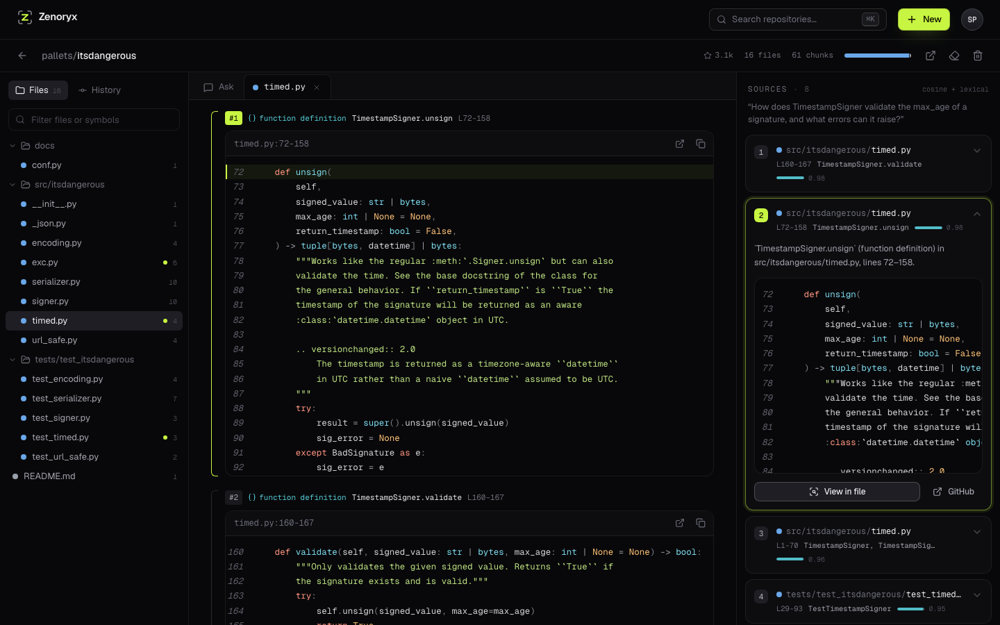
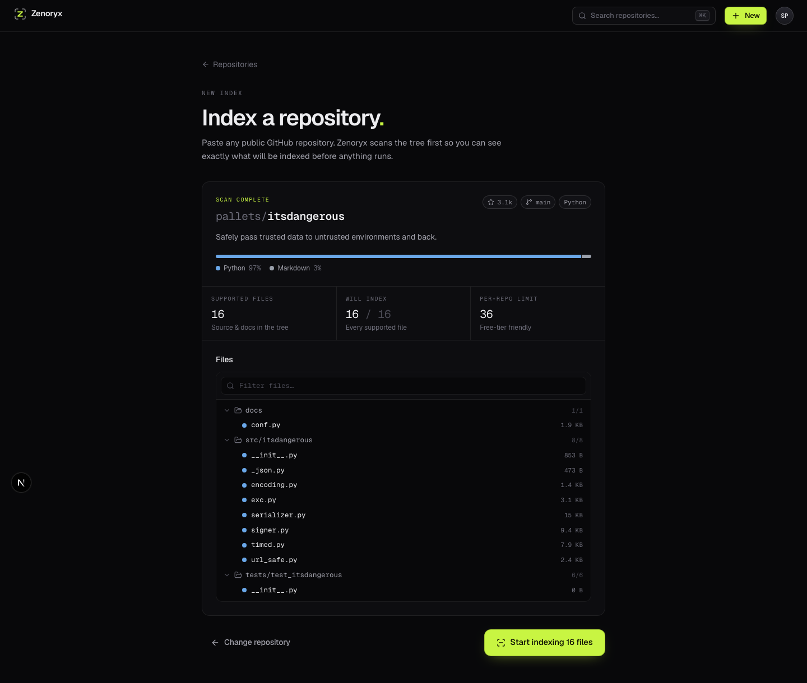
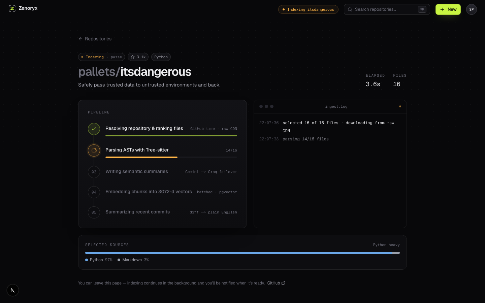

# Zenoryx

**X-ray vision for codebases.** Point Zenoryx at any public GitHub repository and ask it questions in plain English. It parses the code into its real syntax tree, embeds every function and class, and streams back answers in which each claim is cited down to the exact file and line.



<table>
<tr>
<td width="50%"></td>
<td width="50%"></td>
</tr>
<tr>
<td></td>
<td></td>
</tr>
</table>

---

## Highlights

| | |
|---|---|
| **AST-aware chunking** | Tree-sitter grammars (JS, TS, TSX, Python, Java, C++) split files into whole functions, classes and methods. Imports and route wiring outside any declaration are collected into "module" chunks, so no code is dropped. Large classes are split into their methods, and small neighbouring declarations are merged. Unsupported languages fall back to overlapping line windows. |
| **Hybrid retrieval** | pgvector cosine search over 3072-d Gemini embeddings, re-ranked with a lexical boost for exact identifiers (`useAuthStore`, `max_age`). Results are capped per file for diversity, and tests and docs are down-weighted unless the question asks about them. |
| **Cited, streamed answers** | Answers stream over SSE with `[n]` citations. Clicking one shows the retrieved chunk, its line range, and a GitHub link pinned to the exact indexed commit. Conversation history is persisted, so follow-up questions work. |
| **Quota-aware model pool** | Seven free-tier models (Gemini Flash-Lite variants and Groq `gpt-oss`/`qwen`) sit behind one gateway, each with its own RPM/TPM token bucket. Calls wait for budget instead of hitting 429s, and models whose daily quota is spent are parked. Interactive Q&A prefers Gemini; background ingestion prefers Groq. Prompts are sized per model, and streams only fail over before the first token. |
| **Durable job queue in Postgres** | Postgres is the queue, so there's no Redis to keep alive. Jobs are claimed with an atomic `UPDATE … WHERE status='PENDING'`. Transient failures retry with exponential backoff. On shutdown, in-flight jobs go back to the queue, and on boot interrupted work is recovered. A redeploy mid-ingestion loses nothing. |
| **Secure sessions** | Server-side sessions in an HttpOnly, HMAC-SHA256-signed cookie, verified in constant time and revocable instantly. Passwords use bcrypt (cost 12), and login timing is identical for unknown emails. The browser only talks to the Next.js origin (`/api` is proxied), so cookies stay first-party, which matters because Safari blocks third-party cookies. |
| **Free-tier by design** | File contents come from GitHub's raw CDN, which doesn't count against the API rate limit. GitHub works without a token and falls back to anonymous access if a token expires. Embeddings are batched and paced to the free quota. The health check never touches the database, so Neon can scale to zero. Database connections use node-postgres with a cold-start-tolerant timeout. |

## Architecture

```
Browser ──► Next.js 15 (App Router) ──/api proxy──► Express 5 API ──► Postgres + pgvector (Neon)
                                                       │   ▲            ├─ users, sessions
                                                       │   │            ├─ projects  ← also the job queue
                                                       ▼   │            ├─ code_chunks (vector(3072))
                                                 Ingestion runner       └─ commits, chat_messages
                                                 (in-process, durable)
                                                       │
                     ┌─────────────────────────────────┼──────────────────────────────┐
                     ▼                                 ▼                              ▼
          GitHub (REST + raw CDN)        Gemini (embeddings + chat pool)      Groq (chat pool)
```

### Ingestion pipeline

1. **Fetch.** Resolve the default branch and pin its commit SHA. Fetch the full tree in one call and rank files by architectural relevance (entry points and core directories score up; tests, configs and vendored code score down). The top N files are indexed.
2. **Parse.** Download files from the raw CDN in parallel and split them into AST chunks with line ranges.
3. **Summarize.** One LLM call per *group* of files writes a 1–2 sentence role summary per file.
4. **Embed.** Chunks are embedded in batches (with their file's role summary) into 3072-d vectors and bulk-inserted into pgvector.
5. **History.** Recent commits get plain-English summaries of their diffs.

### Q&A

Embed the question (merged with the previous question for short follow-ups) → hybrid search → numbered sources streamed to the client → grounded answer streamed token by token → the exchange is persisted with its sources.

## Tech stack

**Web:** Next.js 15, React 19, Tailwind CSS 4, TanStack Query, react-hook-form + zod, react-markdown, Prism. Fonts: Geist, Geist Mono, Instrument Serif.
**API:** Node 20+, Express 5, Prisma 6 (pg driver adapter), pgvector, Tree-sitter, Octokit, pino, helmet, express-rate-limit.
**AI:** Gemini `gemini-embedding-001` + Flash-Lite pool, Groq `gpt-oss-120b` / `gpt-oss-20b` / `qwen3.8-27b`. All on free tiers.

## Getting started

Prerequisites: Node 20.10+, plus free accounts for [Neon](https://neon.tech) (Postgres), [Google AI Studio](https://aistudio.google.com) (Gemini key) and [Groq](https://console.groq.com). A GitHub token is optional.

```bash
# 1. API
cd backend
cp env.example .env         # fill in the values (see below)
npm install
npm run migrate             # applies Prisma migrations (enables pgvector)
npm run doctor              # checks DB, every model in the pool, embeddings, GitHub
npm run dev                 # http://localhost:8000

# 2. Web (second terminal)
cd frontend
cp .env.example .env        # BACKEND_URL=http://localhost:8000
npm install
npm run dev                 # http://localhost:3000
```

### Environment variables (`backend/.env`)

| Variable | Required | Notes |
|---|---|---|
| `DATABASE_URL` | yes | Postgres with pgvector. Neon: run `CREATE EXTENSION IF NOT EXISTS vector;` once. |
| `COOKIE_SECRET` | yes | 32+ random bytes: `node -e "console.log(require('crypto').randomBytes(32).toString('hex'))"` |
| `GEMINI_API_KEY` | yes | Embeddings + primary chat pool. |
| `GROQ_API_KEY` | recommended | Chat pool for ingestion and failover. |
| `GITHUB_TOKEN` | no | Raises GitHub's limit from 60 to 5,000 req/h. No scopes needed. |
| `PORT` | no | Default `8000`. |
| `FRONTEND_URL` | no | CORS allow-list. Only needed if a browser calls the API cross-origin. |
| `GEMINI_CHAT_MODELS`, `GROQ_CHAT_MODELS` | no | Comma-separated model pools, in preference order. |
| `MAX_FILES`, `MAX_CHUNKS`, `QA_PER_HOUR` | no | Per-repo budget (default 36 files / 180 chunks) and per-user question limit. |

> The committed template is `backend/env.example`. Real `.env*` files are gitignored.

## Testing

```bash
cd backend
npm run test:unit   # pure logic: chunker, URL parsing, ranking, crypto, retrieval, limiter
npm test            # + HTTP integration tests against your database (test users are cleaned up)
npm run test:e2e    # + full flow: validate → ingest a real repo → stream an answer → delete

cd ../frontend
npm run lint && npm run build
```

CI (`.github/workflows/ci.yml`) runs the unit tests, lint and production build on every push.

## Deployment (free)

- **API → Render** (free web service): use `render.yaml` as a Blueprint, or set build `npm ci && npm run build` and start `npm start` with root `backend`. The ingestion runner lives in the same process, so no separate worker service is needed.
- **Web → Vercel**: root `frontend`, env `BACKEND_URL=https://<your-api>.onrender.com`.
- **DB → Neon** free tier.

> Upgrading an older deployment: the API no longer uses Redis/BullMQ. Change the Render start command to `npm start` (it previously launched a separate worker), add `npm run build` so migrations run, and set `BACKEND_URL` on Vercel.

## API reference

All routes are served under `/api` (and at the root for older clients).

| Method | Route | Description |
|---|---|---|
| `POST` | `/auth/register` · `/auth/login` · `/auth/logout` | Session lifecycle. |
| `GET` | `/auth/me` · `/auth/session` | Current user (401 vs. soft `{ user: null }`). |
| `POST` | `/projects/validate` | Pre-flight scan: metadata, language mix, ranked file selection. |
| `POST` | `/projects` | Create and enqueue (returns the existing project for duplicates). |
| `GET` | `/projects` · `/projects/:id` · `/projects/:id/status` | Listing, details, live progress. |
| `POST` | `/projects/:id/retry` | Retry a failed ingestion. |
| `GET` | `/projects/:id/files` · `/projects/:id/chunks?path=` | File explorer and per-file AST chunks. |
| `GET` | `/projects/:id/commits` | AI-summarized commit timeline. |
| `GET` / `DELETE` | `/projects/:id/messages` | Conversation history. |
| `DELETE` | `/projects/:id` | Cancel any running job and delete vectors, commits and chat. |
| `POST` | `/qa` | SSE stream: `sources` → `token`* → `done` \| `error`. |

## Project structure

```
backend/
  src/
    app.js · server.js          Express app (side-effect free) and process entrypoint
    jobs/runner.js · ingest.js  Durable Postgres-backed queue and the ingestion pipeline
    services/                   github · llm (quota-aware pool) · embedding · vector (hybrid search)
    lib/                        chunker (Tree-sitter) · fileUtils (ranking) · githubUrl · logger
    controllers/ routes/ middleware/ auth/ prisma/
  test/                         unit + integration + e2e (node:test)
  scripts/doctor.js             connectivity and quota check for every dependency
frontend/
  app/                          (auth) and (app) route groups, landing, 404, error boundary
  components/
    landing/ auth/ dashboard/ ingest/ workspace/ app/ ui/
  lib/ hooks/                   API client, SSE reader, formatting, pipeline metadata
```

## License

MIT
